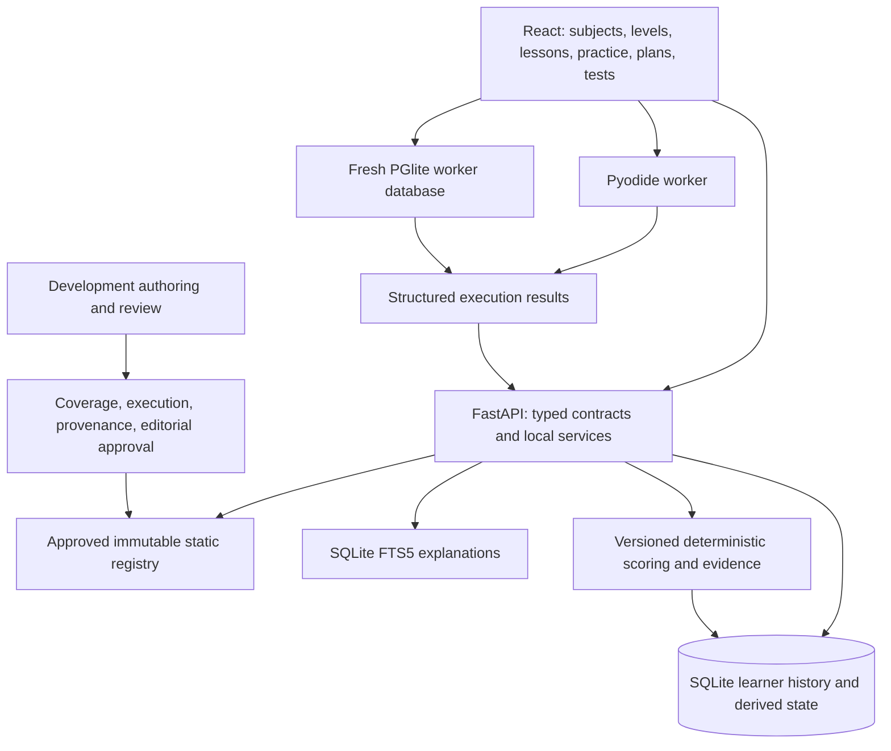

# Forge V1 architecture plan

Status: proposed after inspecting local `main` at `51605d8` plus its existing working-tree changes on 21 October 2026. This is a design, not implemented functionality. See [PHASE0_AUDIT.md](PHASE0_AUDIT.md) for evidence and verification limits.

## 1. Keep the existing application

Use one React/TypeScript frontend, one FastAPI backend, one local SQLite database, the existing learning services and FSRS scheduler, and browser workers for Python and SQL. No microservices, hosted database, vector service, account infrastructure, or runtime model are needed.

Learner operation uses only packaged files and loopback HTTP. Development authoring may use coding agents, but their outputs remain candidates until verified and explicitly approved. The learner application must not import a provider SDK or construct a model client.

## 2. Independent edition, curriculum and content identities

Define three independent version axes:

1. Product edition: stable keys `placement-foundations` (label Forge V1, levels 1–3) and later `advanced-engineering` (label Forge V2, levels 1–5 including the same foundations).
2. Curriculum revision: an immutable confirmed `Curriculum` row and its topic/prerequisite graph. Existing integer revisions 1 and 2 retain their identity and history.
3. Content revision: stable lesson/problem key plus immutable revision and verified content digest. Existing pack `ai-engineer/v1` and lesson `1.1.0` are legacy content identities, not product editions.

Keep edition definitions as a small validated static manifest, not a new entitlement/payment subsystem. An `EditionCurriculumBinding` maps edition and approved catalog release to an exact confirmed curriculum ID. Store the user's edition choice in `AppSetting`; preserve `active_curriculum_id` for curriculum selection. Do not infer either choice from the integer `Curriculum.version`.

Creating the nine-subject curriculum requires a new draft and explicit confirmation/activation. Do not edit the existing confirmed curricula to rename, merge, remove or relabel their topics. Existing and custom curricula remain manually accessible. Product edition navigation is a view over the selected approved curriculum; it does not hide history or authorize score transfer.

## 3. Subject and level navigation

Placement Foundations has exactly the nine subjects in [CURRICULUM_SCOPE.md](CURRICULUM_SCOPE.md). Represent numeric level in an additive `TopicPlacement` association containing curriculum ID, topic ID, stable subject key, and level 1–5; level is not `Topic.target_level` (`working`, etc.) and not mastery.

Navigation: edition -> subject -> level -> topic -> ordered lessons/practice. Every subject/topic remains manually selectable. Prerequisites produce recommendations and context, not route locks. Assessment integrity gates, such as reserved transfer questions or hiding solutions, are distinct from access to subjects.

Retain `CurriculumPage.tsx`, `TopicPage.tsx`, and `LearnPage.tsx`; add subject/level grouping and clear content availability. A listed topic with no approved lesson is explicitly unavailable for teaching, rather than populated by runtime generation. Keep traditional CS in relevant Python/DSA, SQL, system-design and interview lessons.

## 4. Immutable static registry and synchronization

### Registry contract

Add Pydantic schema and local registry service under `apps/api/app/schemas/content_registry.py` and `services/content_registry.py`. Manifest entries contain stable key, revision, type, subject, level, relative path, canonical digest, source records, coverage-spec revision, validation-report digest, approval identity/date, and publication status. Only approved entries resolve at runtime.

Resolve through `TopicContentBinding(curriculum_id, topic_id, content_key, content_revision, role, order_index)`. A consolidated topic can reference multiple lessons; e.g. `pythonic-programming` can explicitly bind comprehensions/iterators/generators after a coverage review. A graph merge must never be guessed from slug similarity. Require the topic to belong to the binding's curriculum, valid ordering, unique references, and allowed paths entirely inside the content root.

For Phase 1, register current files as immutable **legacy baselines**, preserving their provenance and validation limitations. Registration is not a retroactive editorial approval. A compatibility resolver keeps existing legacy reading working while new edition publication accepts only fully approved releases. Persist computed digests separately; do not overwrite the unexplained legacy `content_hash` values or claim their identity equals the new digest.

Long-term path convention for new material: `content/forge/<subject>/<topic>/revisions/<revision>/{lesson,exercises}.json`. Keep existing paths readable for history. Store problem revisions similarly under the existing `content/problem-bank` namespace or a revision subdirectory, rather than replacing a file used by past attempts. No wholesale conversion is required in Phase 0 or Phase 1.

### Synchronization and search

Replace first-track-by-slug lookup with explicit bindings scoped to a curriculum. Idempotent sync registers exact revisions and exercise identities for every mapped topic. Reject missing targets, ambiguous mappings, duplicate identities, invalid digests or partial bundles before making a release visible. Loading an old lesson revision uses that stored revision, never whatever file currently occupies a topic path.

Rebuild FTS5 from active bindings, including curriculum, edition, lesson key/revision and section key. Rebuild only the derived index transactionally; do not delete history. An FTS error should be visible in diagnostics instead of being silently indistinguishable from no matches. Search UI returns exact excerpts, source links, topic and section navigation. No vector database, embeddings, conversational synthesis or remote retrieval is required.

### Learning progress

Keep existing `LessonSectionProgress` rows intact. Add `LessonRevisionProgress(topic_id, content_key, revision, section_slug, status/timestamps)`. Explicit one-to-one section mappings can project legacy progress into a new view; preserve originals and never infer mastery from either completion percentage. A new section/revision does not inherit completion automatically.

## 5. Deterministic assessment engine

Extend existing practice/Arena services around a small shared assessment selection/scoring module. Do not build a second learner/evidence database.

Approved item types:

- MCQ and multi-select: exact stored answer sets; fixed scoring and explanations.
- Numeric/short structured response: a deliberately narrow contract with accepted units, exact rational/decimal normalization or explicit tolerance, bounds, and pre-authored feedback. Avoid grading arbitrary mathematical expressions with unsafe evaluation.
- Python implementation/debugging: existing Pyodide worker with typed fixtures, exceptions, stdin/stdout, bounded runtime and original tests.
- SQL queries: existing fresh PGlite worker with schema fixtures, columns, normalized multiset results by default, explicit ordering where needed, duplicates/null/date/numeric behavior, and alternate datasets. Do not send SQL to Forge SQLite.
- Free-form explanation, project narrative, design discussion and communication: saved reflection with a static rubric/model answer and optional self-check, explicitly unscored. A self-rating is not mastery evidence. Replace key scored concepts with separate objective questions where useful.

Each attempt captures content key/revision/digest, scoring-policy version, runtime version, assistance/reveal state, context (practice/transfer/recall/timed/interview), submitted answer/source, structured execution results, completion state and timestamps. Extend through additive detail tables first; avoid changing every historical row's schema at once.

Backend code derives scores and validates complete result contracts. MCQ/numeric scoring is backend-authoritative. Python/SQL execution remains on the learner's computer in workers; the personal-local edition trusts worker results after structural consistency checks. Do not describe that trust model as cryptographically verified or suitable for remote proctoring. A public high-stakes service would be a separate infrastructure/security scope, not part of V1.

Validation, Run, Submit, hints and solutions remain separate operations. Run checks visible examples and creates no scored evidence. Submit checks the full fixture set. Package reference solutions only in backend/development content; public item DTOs omit answers, solutions, hidden feedback and hint text. Reveal a solution only after pass or explicit Give Up. Revealing help during an open transfer marks it assisted at the backend, including static explanation/search help. Do not rely only on hidden buttons.

### Pool purpose and exhaustion

An assessment manifest marks variants for practice, transfer, recall and scored mock tests. A transfer task must be a reviewed independent variant in a different context, not a lightly renamed item. Select deterministically using seeded ordering and stored item IDs. Store exposure and reveal records; retain the first-session selection for resume/retry.

Practice can be repeated for learning, with explicit policy limiting duplicate mastery credit. Transfer excludes prior exposed, solved, hinted or revealed variants. Recall uses appropriate delayed variants; known questions cannot be passed off as unseen transfer. When a pool is exhausted, say so and offer normal practice; never call a model or silently count a repeat as new independent evidence.

## 6. Mastery, confidence, readiness and scheduling

Reuse `MasteryEvidenceEvent`, `mastery.py`, `readiness.py`, and `review.py` with versioned deterministic policies. Preserve these invariants:

- Only completed objective assessments append scored evidence. Pending, unsupported or reflective answers append none.
- Practice cap 79; clean unassisted transfer cap 89; 90+ requires successful recall at least 24 elapsed hours after qualifying transfer.
- Weak delayed recall can reduce mastery. Chat, reading, streaks, study time and planner checkmarks never raise it.
- Python, SQL and DSA need independent coding evidence; MCQ-only repetition cannot satisfy their transfer gate.
- Hints/help/reveals reduce evidence or disqualify clean transfer according to fixed code policy. Never let a model or self-rating choose a mastery score, confidence, readiness, mistake category, FSRS rating or interval.
- FSRS state remains versioned; the objective score-to-rating function stays deterministic. Review events record prior/next due dates and rating-policy version.
- Behavioral reflection never changes technical mastery; Forge Interview Score is never a hiring probability.

Repair Arena integration by including qualifying Arena events in a defined practice projection, retaining original `event_type="arena"`. An event must have a stable attempt identity and idempotency key. Existing events lacking a direct Arena-attempt ID need explicit provenance links only when uniquely matchable; leave ambiguous records unchanged and visible in diagnostics. Do not manufacture attempts or duplicate events. A new calculation version can replay historical evidence into a separately versioned projection while preserving the original rows and old-policy snapshot.

Do not automatically copy a high legacy score to a narrower new concept. Exact topic equivalence may support a lineage view over the original evidence; split/merge cases require fresh evidence or a reviewed per-competency mapping. Delay any broad scoring-policy change until its replay effects are reviewed on a copied database.

## 7. Daily study planner

Extend `planner.py`, `schemas/adaptive.py`, and Settings/Dashboard. Accept presets 300, 360 and 480 **study minutes**, plus custom targets within supported bounds. Specify breaks separately so users know whether a schedule includes them.

Use deterministic allocation over available approved content and objective assessments:

1. Reserve a bounded review budget for due recall; carry excess reviews forward visibly rather than overflowing the day.
2. Allocate foundational Python, SQL and DSA minima while those tracks need work. Make zero minima an explicit user preference and never let minimum totals exceed the chosen target without explaining an adjustment.
3. Distribute remaining time across weak topics, beginner learning, aptitude/reasoning/English and an interview-preparation rotation. Use per-subject caps and stable tie-breaks to prevent a single high-priority track consuming the remainder.
4. Select learning before advanced practice when prerequisites are weak, but preserve free manual access. Coding actions carry subject/topic filters into Arena.
5. Add interview/communication reflection without treating it as technical evidence. Report gaps when no approved activity can fill a slot.

Budget invariants: planned study minutes never exceed target; clip only activities that support shorter blocks, otherwise choose a fitting task. Show unused minutes and unavailable-content reasons rather than inventing work. Persist local date/timezone, settings/policy version, selected activity revisions, user completion/skip state and plan revision. Use Asia/Calcutta when selected by this learner; FSRS and elapsed 24-hour gates stay in UTC. Changing settings offers explicit regeneration and retains completed/skipped items.

## 8. Timed tests and interview practice

Add a small timed-session model to reuse approved question pools and shared scoring. Blueprint version fixes subject/level coverage, question types, weights, duration, optional negative marking, and deterministic follow-up rules. Test sessions snapshot blueprint and selected item revisions; store start/deadline, answers, submit/expiry status and policy version. Timer display derives from persisted deadline, survives refresh, and cannot restart the assessment. Submission and expiry are idempotent.

During a scored timed/interview session, suppress answer/rubric-detail/solution endpoints and enforce help restrictions on the backend. Return only progress/acknowledgment until completion. Pre-authored explanations become visible after the whole scored session completes, not after each question.

Refactor `interview.py` around its existing fixed blueprints and history storage. Add Placement Foundations static blueprints; preserve legacy blueprint identities for old reports. At most one prewritten contextual follow-up per main question, selected by a deterministic rule from structured results. Fixed weights remain in code/approved blueprints.

Offer two transparent experiences:

- Scored objective mock interview: static MCQ/numeric/code/SQL questions with deterministic section and overall scores.
- Communication/project/system-design rehearsal: written responses, timers, prewritten rubrics, examples and self-reflection. Do not fabricate automated behavioral or open-text correctness scores. Reports separate reflection from scored sections; unscored work cannot silently become zero or inflate the score denominator.

Static rubric dimensions such as clarity/ownership help reflection, but word counts or keyword overlap are not a substitute for evaluating communication quality. AI fundamentals can be assessed with static scenarios and recorded outputs; there is no runtime model requirement even when teaching RAG/agents.

## 9. Database upgrade and preservation design

### Upgrade mechanism

Introduce a minimal numbered migration runner rather than adding infrastructure by default. `SchemaMigration(version, checksum, applied_at)` tracks exact migrations. Refuse modified applied scripts or unknown/newer schemas. Run each schema migration atomically where supported; run long derived-index rebuilds as resumable steps with explicit state. Use `create_all` only for fresh initialization through the same version path, not as an implicit existing-schema upgrade.

Before an upgrade, quiesce writes and create a consistent SQLite backup using the backup API. Do not copy only a live main file when WAL sidecars may contain data. Verify that the backup opens and passes integrity checks, record schema/content digests and per-table counts, and retain it for rollback. The backup/restore path must stay inside an explicit learner-selected location. Free disk space and backup failure abort the upgrade safely.

Additive tables, in stages:

- Phase 1: migration ledger; `ContentRevision` and `TopicContentBinding`, plus explicit `ArenaTopicBinding` for curriculum-scoped Arena mappings. Immutable content records hold computed digest, path, type and legacy/approval status. Do not add edition/level behavior yet.
- Edition phase: `EditionCurriculumBinding`, `TopicPlacement` and `LessonRevisionProgress`.
- Assessment phase: `AssessmentItemRevision` or registry-backed assessment details, `AssessmentExposure`, and additive `AttemptContentSnapshot`/Arena-attempt content linkage; unique evidence-source association and scoring-policy version.
- Timed/interview phase: `TimedAssessmentSession`, `TimedAssessmentAnswer` and versioned blueprint/question links; retain existing interview tables and reports.
- Planner phase: `DailyPlanRevision` metadata and additive links from existing plan items; preserve item IDs/statuses.

Prefer associations to intrusive column rewrites. Enforce foreign keys, unique content identity, correct curriculum/topic ownership and idempotency on new tables. Audit existing foreign-key inconsistencies before enabling stronger checks; never “repair” them by deleting history.

### Preservation rules

Never drop/reseed learner tables or recycle IDs. Existing confirmed curricula remain byte-for-byte structurally equivalent. Preserve attempts, code, pending details, hints, mistakes, chat, reports, reviews, FSRS card JSON, section completion, usage and migration maps. Retiring content only changes availability for future sessions; historical views resolve the original immutable revision/snapshot.

Keep legacy fields such as `generated_by="gemini"` and historical grading sources as facts. Removing provider code does not require dropping usage, chat or generated-exercise data. Runtime legacy sessions requiring a provider become read-only history or clearly unsupported continuation; do not invent evaluations. Existing completed reports stay readable even after mode definitions evolve.

Topic mapping never reassigns an old attempt's topic ID. New associations can expose lineage with original provenance. Recalculation is an explicit, versioned projection step, not a silent migration side effect. Keep existing active curriculum unless the learner explicitly changes it; remove the unconditional legacy activation behavior as the new selection flow lands.

### Upgrade acceptance tests

Use synthetic fixtures representing populated old schemas, both curriculum revisions, custom drafts/confirmed curricula, nonzero progress, completed and pending attempts, old/mapped/ambiguous Arena evidence, assisted transfers, delayed recall, FSRS state, saved interviews, and historical AI metadata. Test fresh install, upgrade, interrupted migration, repeat upgrade, invalid content, backup failure and restoration. Compare primary keys and complete historical row payloads/digests before/after, not just totals. Rebuild derived indexes independently and verify old/new curriculum search scoping. Never use the learner's ordinary DB as a mutable test fixture.

## 10. Content verification and publication workflow

1. **Scope first:** approve a versioned concept/competency matrix, level outcomes, prerequisites, item purposes and boundaries. Coverage is concepts with concrete checks, not keyword occurrence alone.
2. **Sources:** select explicit reputable public references. Register exact URLs, publisher, source ID, retrieved date/version/commit, permitted use, license identifier/text, attribution and content digest. Retain needed snapshots within permitted use. Reject paid/authenticated/prohibited/reference-only corpus fetching. Verify redirect destination and robots policy before retrieval.
3. **Author candidate:** write original, short, friendly sections with analogies, worked steps, common mistakes, checkpoints, original practice, progressive hints and verified solutions. Coding agents can assist development; no material is published by generation alone.
4. **Automated validation:** validate exact lesson/exercise/problem candidate bundle against schema, coverage IDs, cross-references, registry membership, attribution and hashes. Execute Python examples/reference solutions with bounded isolated development processes and the Pyodide harness; execute SQL examples/references in fresh PGlite fixtures. Verify output types, units/tolerances, duplicate/null/order semantics, and error contracts. Bind displayed examples to machine-readable fixture IDs so a tuple/list discrepancy cannot pass. Include deliberately wrong solutions to prove tests reject common mistakes.
5. **Review:** record technical review and a separate clarity/beginner-accessibility checklist. Check conceptual coverage, sequencing, ambiguity, edge cases, credible examples, repetition and source fidelity. Unautomatable free-text/model answers need review, not a claimed test pass.
6. **Approve:** an explicit approval record identifies exact bundle digest, reviewer, date, coverage revision and validation results. Missing/failed/stale checks block publication. An approval cannot apply to subsequently changed bytes.
7. **Publish:** atomically add a new immutable approved revision and registry release. Never overwrite an accepted revision. New startup/runtime resolves only the selected release; rollback switches release bindings while retaining history.

Fix candidate validation first: pass both candidate file paths explicitly, validate them together, then approve/promote. A test must prove that valid accepted exercises cannot mask an invalid exercise candidate. Extend source/provenance schemas instead of losing extra JSON metadata during Pydantic serialization.

Publication policy for the new Arena release is original Forge-authored challenges. Existing adapted content needs preserved attribution/history and a deliberate decision to keep it as a separately identified legacy bank or replace future availability with newly authored original tasks. Do not copy proprietary challenge statements, editorial solutions or private tests. A platform's public accessibility is not permission to copy.

The Python documentation identifies PSF licensing and separately describes dual licensing for documentation code examples; retain applicable notices when material is reused. [Python license](https://docs.python.org/3/license.html). PostgreSQL's license page includes notice requirements for software/documentation copies. [PostgreSQL license](https://www.postgresql.org/about/licence/). Exercism's Python repository identifies its MIT license; current local attribution still needs per-item upstream/version reconciliation. [Exercism Python license](https://github.com/exercism/python/blob/main/LICENSE). These primary pages were consulted on the audit date; this does not establish the provenance or permitted use of every existing Forge paragraph.

## 11. Removing runtime AI without data loss

Migrate complete user flows before removing shared contracts. Static search replaces doubts; guided static reading replaces Tutor; manual templates/drafts replace generated curricula; objective items and reflection replace free-text model grades; reserved pools replace transfer/review generation; static blueprints replace interview generation/narratives. Settings must load independently of `/api/ai/status` before that endpoint is removed.

Then remove runtime `providers`, model-only services, router registration, Gemini settings, and `google-genai` from runtime requirements. Keep any optional development authoring dependencies in a separate development environment. Preserve old records and DTOs needed to render history. Stop exposing pending reference solutions and hide all hint text until tracked reveal.

Automated no-network tests must cover startup, Learn/search, practice, transfer, due recall, Arena, planning, timed tests, scored mocks and historical reports. A sentinel provider/import failure should make accidental model dependency fail immediately. No API purchase or live model call is part of verification.

## 12. Offline operation and release boundary

Use the existing production Vite build served by FastAPI and the Windows loopback launcher. Bundle Monaco assets/workers, Pyodide core/stdlib, PGlite WASM/data, fonts, content and attribution. Audit for CDN URLs, remote fonts, dynamic package loading and development-only network fallbacks. Offline here means the installed local server works after dependencies/assets have been installed; it does not imply a serverless PWA. A service worker or desktop wrapper is unnecessary for V1.

Harden launcher identity checks, startup diagnostics and safe path handling. Test port fallback, duplicate launch, missing build, shutdown and stale PID state in an isolated runtime directory/database; never close a user's existing process during automated tests. Check real browser worker loading and timeout recovery with external networking disabled. Build success alone does not establish WASM loading or complete offline use.

Release only when all nine subjects have approved Levels 1–3 coverage, assessed skills have objective evidence or are explicitly reflective, all model dependencies are absent from runtime, upgrades preserve historical data, and the 5/6/8-hour planner satisfies deterministic budgets/diversity while preserving manual navigation. Later Levels 4–5 extend the same registry, edition bindings and assessment infrastructure.
