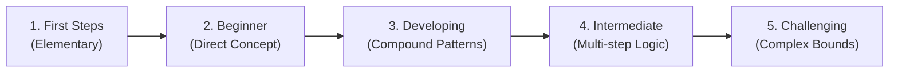

# Forge V1 — Beginner Exercise Coverage and Arena Stages Report

**Author**: Antigravity Assistant & Engineering Pair  
**Date**: October 22, 2026  
**Status**: Authoritative Reference  
**Authoritative Local Tree**: `C:\My PC\git\Forge`  
**Classification**: Beginner Python/SQL/DSA path partly usable  

---

## 1. Overview of Arena Redesign

The Coding Arena has been restructured from an unstructured collection of 110 coding challenges into a **five-stage progressive learning journey**, while preserving all existing problem identities, attempts, and judge infrastructure in an accessible **Challenge Library**.

### The 5 Progression Stages
1. **First Steps**:
   - Zero or single elementary prerequisites.
   - Focus: Syntactic mechanics, basic input/output, tracing variables, constant queries, and simple scans.
2. **Beginner**:
   - Direct concept application with clean contracts.
   - Focus: Function definition, basic math, simple conditionals, single-table SQL filters, linear search.
3. **Developing**:
   - Connecting two concepts or simple algorithmic patterns.
   - Focus: Two pointers, basic sliding window, simple joins, group-by aggregations, basic recursion.
4. **Intermediate**:
   - Multi-step logic, non-trivial data structures, and state management.
   - Focus: Stacks/queues, binary search trees, subqueries, CTEs, dynamic programming fundamentals.
5. **Challenging**:
   - Advanced algorithms, tight asymptotic time/space bounds, and complex edge cases.
   - Focus: Graphs, topological sort, complex DP, window functions, advanced tree operations.

---

## 2. Challenge Library: 110 Original Problems Preserved

All 110 original problems in `content/problem-bank/` have been mapped into `data/learning-path/arena-stages.json` with explicit concept tags and prerequisites:

| Track | Problem Count | First Steps | Beginner | Developing | Intermediate | Challenging |
| :--- | :---: | :---: | :---: | :---: | :---: | :---: |
| **Python** | 40 | 6 | 10 | 12 | 8 | 4 |
| **SQL** | 30 | 5 | 8 | 8 | 6 | 3 |
| **DSA** | 40 | 4 | 9 | 11 | 10 | 6 |
| **Total** | **110** | **15** | **27** | **31** | **24** | **13** |

*Note: All original JSON problem definitions, revisions, judge harnesses, and historical learner attempts remain intact and accessible via the Challenge Library tab at `/arena`.*

---

## 3. Authored First Steps Beginner Exercises

To eliminate the "empty first day" problem where beginners were faced with hard algorithmic problems, 14 dedicated, beginner-first interactive exercises have been authored and verified in `data/learning-path/beginner-exercises.json`:

### Python First Steps (7 Exercises)
1. **`py-first-print-message`**: Printing a message
   - *Concept*: `step-py-values-1`
   - *Task*: Define `say_hello()` returning `'Hello, Forge!'`.
   - *Starter Code*: `def say_hello():\n    pass`
   - *Tests*: Exact string equality verification.
2. **`py-first-variable`**: Work with one variable
   - *Concept*: `step-py-values-1`
   - *Task*: Define `double_value(x)` assigning $x \times 2$ to variable `result`.
   - *Tests*: Multi-parameter verification across positive, zero, and negative values.
3. **`py-first-add-two`**: Add two numbers
   - *Concept*: `step-py-values-2`
   - *Task*: Define `add_numbers(a, b)` returning $a + b$.
   - *Tests*: Integer addition test cases.
4. **`py-first-compare-two`**: Compare two numbers
   - *Concept*: `step-py-cond-1`
   - *Task*: Define `is_greater(a, b)` returning boolean result of $a > b$.
   - *Tests*: Greater, equal, and smaller comparisons.
5. **`py-first-even-odd`**: Check even or odd
   - *Concept*: `step-py-cond-1`
   - *Task*: Define `check_even_odd(n)` returning `'even'` or `'odd'`.
   - *Tests*: Tests with 4, 7, 0, -3.
6. **`py-first-count-numbers`**: Count numbers
   - *Concept*: `step-py-loops-1`
   - *Task*: Define `count_positives(numbers)` counting numbers $> 0$.
   - *Tests*: Lists with mixed positive and negative numbers.
7. **`py-first-find-max`**: Find maximum in a list
   - *Concept*: `step-py-loops-1`
   - *Task*: Define `find_maximum(numbers)` without using the built-in `max()`.
   - *Tests*: Array scanning and element tracking.

### SQL First Steps (4 Exercises)
1. **`sql-first-select-constant`**: SELECT a constant
   - *Concept*: `step-sql-select-1`
   - *Task*: Write a query selecting constant `42 AS answer`.
   - *Contract*: Column `answer`, single row `[42]`.
2. **`sql-first-read-one-col`**: Read one column
   - *Concept*: `step-sql-select-1`
   - *Task*: `SELECT title FROM books;`
   - *Contract*: Single column selection from visible fixture table.
3. **`sql-first-where`**: Filter rows with WHERE
   - *Concept*: `step-sql-where-1`
   - *Task*: `SELECT name FROM employees WHERE department = 'Engineering';`
   - *Contract*: String equality filtering.
4. **`sql-first-null-check`**: Filter NULL values
   - *Concept*: `step-sql-where-1`
   - *Task*: `SELECT id, name FROM users WHERE email IS NULL;`
   - *Contract*: Correct usage of `IS NULL` instead of `= NULL`.

### DSA First Steps (3 Exercises)
1. **`dsa-first-tracing-list`**: Tracing an array & accumulation
   - *Concept*: `step-dsa-arrays-1`
   - *Task*: Define `sum_elements(arr)` calculating sum by explicit element traversal.
   - *Tests*: Array indexing and element summation.
2. **`dsa-first-linear-scan`**: Linear search
   - *Concept*: `step-dsa-arrays-1`
   - *Task*: Define `find_index(arr, target)` returning the index of target or -1.
   - *Tests*: Searching existing and absent elements.
3. **`dsa-first-freq-counting`**: Frequency counting
   - *Concept*: `step-dsa-arrays-2`
   - *Task*: Define `count_frequencies(items)` returning a dict of occurrences.
   - *Tests*: Dict accumulation over repeated items.

---

## 4. Judging, Sandbox Security & Safeguards

The evaluation pipeline guarantees safety and pedagogical rigor:
- **Pyodide Worker**: Learner Python executes in a Web Worker in the browser, isolated from UI rendering and local storage.
- **Backend Verification**: `evaluate_beginner_exercise` executes Python within restricted builtins and AST validation.
- **PGlite Worker**: SQL queries run against a freshly initialized, isolated in-browser PostgreSQL instance with zero network access and no Forge SQLite catalog access.
- **Hidden Reference Solutions**: The authored reference solution and full explanation are strictly hidden until the learner achieves 100% test case pass.
- **Progress Tracking**: Completed beginner exercises append solve events to `AppSetting` (`lp_ex_solved:<key>`) without manufacturing unearned mastery scores.
