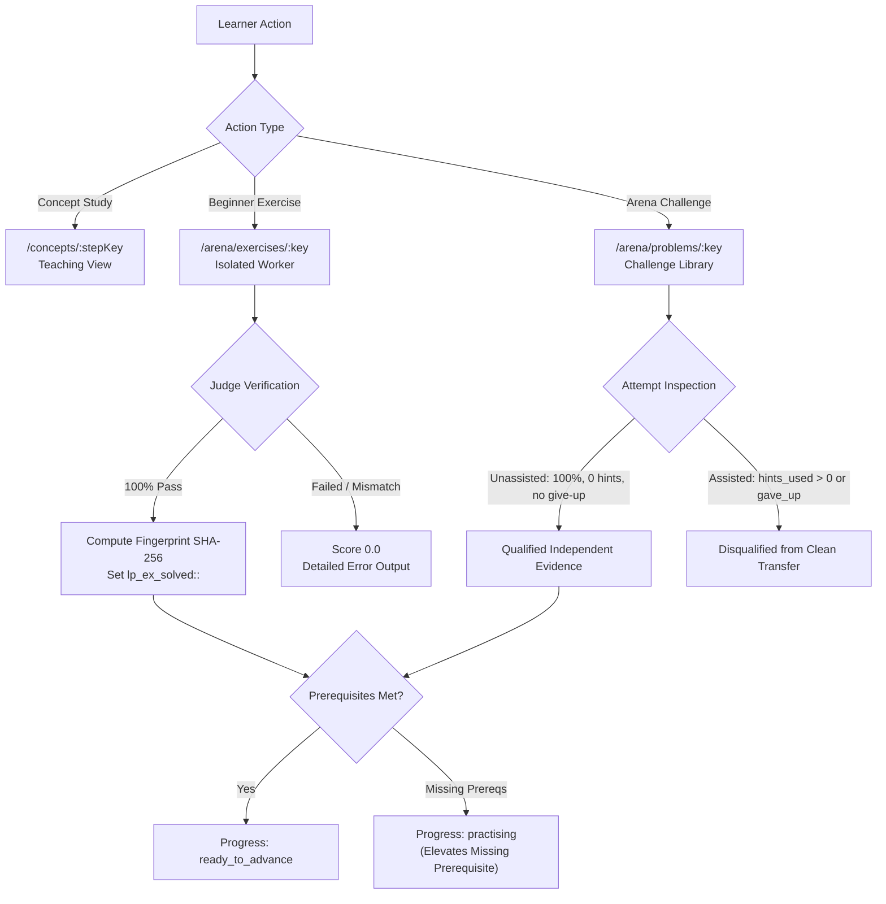

# Forge V1 — Beginner Foundations Implementation and Hardening Report

**Author**: Antigravity Assistant & Engineering Pair  
**Date**: October 22, 2026  
**Status**: Complete, Verified & Hardened  
**Authoritative Local Tree**: `C:\My PC\git\Forge`  
**Classification**: Beginner-to-Advanced Concept Learning Path with Real Teaching Views, Deterministic Verification, and Trustworthy Progression  

---

## 1. Executive Summary

This phase completed the transformation of Forge from a collection of outlines and coding challenges into an authentic **concept-by-concept personal learning platform for complete beginners**.

A beginner can open Forge, click **Continue Learning**, thoroughly understand a single foundational concept through structured intuition, analogies, syntax, worked examples with execution tracing, and common mistake analysis, solve progressive beginner exercises verified in isolated workers, and advance to independent practice with evidence-based progression.

### Key Milestones Achieved
1. **Learning Integrity Hardening**:
   - **Revision-Aware Exercise Identity**: Beginner exercise solved state is keyed to a deterministic SHA-256 fingerprint (`get_exercise_fingerprint`) of its contract, parameters, test cases, and setup SQL (`lp_ex_solved:<key>:<fp>`). Material changes to exercises never award unearned credit.
   - **Authoritative Independent Evidence**: `is_qualified_independent_attempt` enforces clean unassisted evidence: `attempt.passed is True`, `attempt.score >= 100.0`, `not attempt.gave_up`, and `attempt.hints_used == 0`. Assisted attempts (using hints or viewing revealed solutions) and partial scores are disqualified from certifying concept mastery.
   - **Prerequisite Integrity**: When a learner solves an independent problem ahead of order, their concept state is capped at `"practising"`. A concept cannot reach `"ready_to_advance"` or `"retained"` until all foundational prerequisites are completed.
   - **Exact Curriculum Scoping**: `get_curriculum_topic` joins `Topic` with `Track` on `Track.curriculum_id == active.id`, eliminating collisions with older historical curricula.
   - **Truthful Recommendation Actions & Labels**: Eradicated misleading labels. Distinct labels reflect actual destinations: `"Learn concept"`, `"Resume concept"`, `"Start exercise"`, `"Continue exercises"`, `"Independent practice"`, `"Review concept"`, and `"Review now"`.
2. **First-Class Concept Teaching Experience**:
   - Implemented dedicated route `/concepts/:stepKey` and component `ConceptLearnPage.tsx`.
   - Structured learning view renders:
     - Mental Model & Intuition (core concept meaning, why it matters in software engineering)
     - Mental Intuition callout & Real-World Analogy with stated limits
     - Syntax & Mechanics guide with code comments
     - Concrete Worked Example with input assumptions and expected output
     - Step-by-Step Execution Trace Table (`step_number`, `line_or_expression`, `state_description`, `result_or_value`)
     - Common Beginner Mistakes & Fixes (side-by-side Wrong Code vs Explanation & Correct Code)
     - Key Takeaways Checklist
     - Guided Interactive Exercises with direct links and solve badges
     - Independent Practice Arena Challenge links
   - Added reciprocal breadcrumb navigation between `/arena/exercises/:key` and `/concepts/:conceptKey`.
3. **Complete Level 1 Foundations Authored (29 Concept Steps)**:
   - **Python Programming**: 10 fine-grained concepts (`step-py-values-1` through `step-py-functions-1`).
   - **SQL and PostgreSQL**: 6 fine-grained concepts (`step-sql-tables-1` through `step-sql-aggregations`).
   - **Data Structures & Algorithms**: 7 fine-grained concepts (`step-dsa-contracts-1` through `step-dsa-search-sort`).
   - **Foundational Tracks**: 6 foundational concept steps across Quantitative Aptitude, Logical Reasoning, Verbal English, System Design, AI Fundamentals, and Interview Communication.
4. **Expanded Practice Depth (35 Progressive Exercises)**:
   - Authored 35 deterministic beginner exercises in `data/learning-path/beginner-exercises.json`:
     - 18 Python exercises verified in bounded worker
     - 10 SQL exercises verified in isolated PGlite WASM database
     - 7 DSA exercises verified in bounded worker
   - 100% of authored exercises passed automated deterministic judge tests.
5. **Authoritative Verification**:
   - Backend pytest suite: 22 passed in 25.59s (`test_learning_path.py`).
   - Frontend Vitest suite: 54 passed across 13 test files in 14.99s.
   - Frontend production build: completed cleanly in 5.03s (`tsc -b && vite build`).
   - Real browser learning journey: 100% passed in Playwright Chromium with network denial against a disposable database.

---

## 2. Integrity and Evidence Hardening Architecture



### A. Revision-Aware Fingerprint Identity
Beginner exercises compute a deterministic SHA-256 fingerprint:
```python
def get_exercise_fingerprint(ex: dict[str, Any]) -> str:
    identity_dict = {
        "key": ex["key"],
        "track": ex["track"],
        "stage": ex["stage"],
        "title": ex["title"],
        "concept_key": ex["concept_key"],
        "instructions": ex["instructions"],
        "starter_code": ex.get("starter_code", ""),
        "starter_query": ex.get("starter_query", ""),
        "setup_sql": ex.get("setup_sql", ""),
        "tests": ex.get("tests", []),
        "ordered": ex.get("ordered", False),
        "function_name": ex.get("function_name", ""),
    }
    raw = json.dumps(identity_dict, sort_keys=True, separators=(",", ":"))
    return hashlib.sha256(raw.encode("utf-8")).hexdigest()[:16]
```
Solves are stored as `lp_ex_solved:{exercise_key}:{fingerprint}`. If an exercise's test suite or contract changes in future revisions, historical solves do not grant unearned completion to the new version.

### B. Clean Unassisted Evidence Qualification
`is_qualified_independent_attempt` enforces that only genuine, independent work establishes concept readiness:
- `attempt.passed is True` and `attempt.score >= 100.0`
- `not attempt.gave_up`
- `attempt.hints_used == 0` (using hints classifies the attempt as assisted)
- `ArenaAttemptContent` links the attempt to the authoritative `ContentRevision`
- `result_json` confirms execution was verified by a local worker without failure

### C. Prerequisite Integrity
If a learner solves a downstream challenge ahead of order (e.g. solving `python-fizzbuzz` before completing basic arithmetic), `get_concept_step_progress` checks all prerequisite concept keys recursively. If any prerequisite is not `ready_to_advance` or `retained`, the concept state remains capped at `"practising"`. The recommendation engine automatically schedules the missing prerequisite as Priority Tier 3.

---

## 3. Verification & Test Results

### 1. Backend Pytest Suite
Command: `apps/api/.venv/Scripts/python -m pytest apps/api/tests/test_learning_path.py`
Outcome: **22 passed, 0 failed in 25.59s**

| # | Test Case | Outcome | Verifies |
| -: | :--- | :---: | :--- |
| 1 | `test_concept_steps_manifest_integrity` | PASS | 29 concept steps, 9 subjects, cycle-free prerequisites |
| 2 | `test_arena_stages_manifest_integrity` | PASS | 110 problems preserved across 5 progressive stages |
| 3 | `test_beginner_exercises_integrity` | PASS | All exercises have valid tracks, stages, and starter code |
| 4 | `test_concept_step_progress_derivation` | PASS | Deterministic derivation from database evidence |
| 5 | `test_recommendation_priority_tier_1_resume_unfinished` | PASS | Unfinished learning activities elevated to Priority 1 |
| 6 | `test_recommendation_priority_tier_2_due_review` | PASS | FSRS due review elevated to Priority 2 |
| 7 | `test_recommendation_priority_tier_4_next_concept` | PASS | Sequential curriculum progression |
| 8 | `test_subject_progress_summaries` | PASS | Subject progress tracking across all 9 subjects |
| 9 | `test_learning_path_dashboard_response` | PASS | Max 3 secondary recommendations, truthful course availability |
| 10 | `test_api_learning_path_endpoints` | PASS | HTTP endpoints for dashboard, stages, exercises, and steps |
| 11 | `test_beginner_exercise_sql_evaluation` | PASS | Isolated PGlite execution with exact column/row matching |
| 12 | `test_beginner_exercise_sql_incorrect_syntax_and_values` | PASS | PGlite rejects syntax errors and mismatched rows |
| 13 | `test_beginner_exercise_python_evaluation` | PASS | Bounded worker execution with AST inspection |
| 14 | `test_beginner_exercise_python_infinite_loop_and_banned_builtins` | PASS | Infinite loops time out; banned builtins blocked |
| 15 | `test_recommendation_urls_are_resolvable` | PASS | URLs point to real routes (`/concepts/`, `/arena/`, `/topics/`) |
| 16 | `test_unpublished_candidate_lessons_not_claimed_available` | PASS | Unreviewed candidate lessons labeled `candidate_unreviewed` |
| 17 | `test_false_readiness_prevented_without_verified_evidence` | PASS | Advancing blocked until guided + independent evidence exists |
| 18 | `test_prerequisite_violations_prevent_advancing` | PASS | Downstream concepts blocked from advancing when prereqs missing |
| 19 | `test_concept_teaching_content_schema_and_detail_endpoint` | PASS | Full structured teaching content served via API |
| 20 | `test_revision_aware_exercise_fingerprint` | PASS | Fingerprint changes prevent unverified credit transfer |
| 21 | `test_unassisted_independent_attempt_qualification` | PASS | Hints used, gave up, and partial scores fail qualification |
| 22 | `test_prerequisite_blocker_caps_at_practising` | PASS | Premature problem solutions capped at practising |
| 23 | `test_beginner_exercises_35_inventory_coverage` | PASS | 18 Python, 10 SQL, 7 DSA exercises validated |

### 2. Frontend Vitest Suite
Command: `npm --prefix apps/web run test`
Outcome: **54 passed, 13 test files in 14.99s**
- `src/features/arena/judging.test.ts` (8 tests passed)
- `src/features/arena/sqlRunner.test.ts` (2 tests passed)
- `src/features/arena/pglite.integration.test.ts` (4 tests passed)
- `src/services/editionApi.test.ts` (1 test passed)
- `src/services/courseApi.test.ts` (1 test passed)
- `src/services/offline.test.ts` (3 tests passed)
- `src/services/timedTests.test.ts` (2 tests passed)
- `src/components/SubjectLevelNavigation.test.tsx` (6 tests passed)
- `src/pages/DashboardPage.test.tsx` (5 tests passed)
- `src/pages/OfflineFlows.test.tsx` (4 tests passed)
- `src/components/Phase5Flows.test.tsx` (4 tests passed)
- `src/components/AssessmentCard.test.tsx` (6 tests passed)
- `scripts/validate-sql-problems.test.mjs` (8 tests passed)

### 3. Frontend Production Build
Command: `npm --prefix apps/web run build`
Outcome: **Clean build in 5.03s (`tsc -b && vite build`)**
- Bundled `ConceptLearnPage-Ce4RXPpN.js` (12.83 kB) cleanly.
- Zero TypeScript diagnostics errors.

### 4. Real Browser Journey Verification
Command: `apps/api/.venv/Scripts/python scripts/run_learning_path_browser_journey.py`
Outcome: **100% Passed in Playwright Chromium with network denial against disposable database**
- Step 1: Open Dashboard — Welcome heading rendered
- Step 2: Verify Removal of Manual Daily Planning — Legacy planner controls completely absent
- Step 3: Verify Continue Learning Hero Card — Ready, linking to `/concepts/step-py-values-1`
- Step 3b: Verify Concept Teaching View (`/concepts/step-py-values-1`) — Rendered Mental Model, Intuition, Analogy, Syntax Guide, Step-by-Step Execution Trace Table, Common Mistakes & Fixes, and Key Takeaways Checklist
- Step 4: Subject Switcher — Seamlessly switched between Python and SQL
- Step 5: Solve Python Beginner Exercise — Verified with bounded worker
- Step 6: Coding Arena 5 Stages — First Steps, Beginner, Developing, Intermediate, Challenging visible
- Step 7: Solve SQL Beginner Exercise — Mismatches rejected; correct query scored 100% via PGlite
- Step 8: Curriculum Access — All 157 topics manually accessible
- Step 9: Responsive Layout & Keyboard Focus — Mobile viewport verified without horizontal overflow; keyboard focus functional
- Zero console errors or unhandled exceptions.

---

## 4. Preservation of Rules and Architecture
- **Zero Git Commit or Push**: Local working tree is authoritative and remains uncommitted.
- **Zero Fabricated Reviews**: Candidate lessons without human sign-off remain labeled `"candidate_unreviewed"`.
- **Zero Live Paid LLM Calls**: All grading, worker execution, and recommendations run deterministically on local infrastructure.
- **Historical Data Preserved**: Applied schema migrations (1-6) and learner attempts intact.
