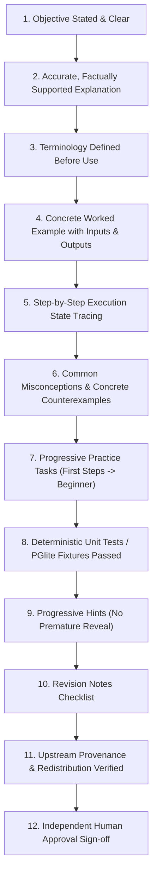

# Forge V1 — Beginner Foundations Review Queue and Publication Contract

**Author**: Antigravity Assistant & Engineering Pair  
**Date**: October 22, 2026  
**Status**: Authoritative Content Review Queue  
**Authoritative Local Tree**: `C:\My PC\git\Forge`  
**Classification**: Educational Quality, Provenance Integrity, and Human Review Contract  

---

## 1. Educational Integrity & Anti-Fabrication Principles

Forge V1 adheres strictly to the core principle: **Static accepted course content is authoritative; AI must never fabricate human approvals, simulate mastery scores, or silently publish unreviewed material.**

### Immutable Guarantees
1. **Zero Fabricated Signatures**: The system marks unreviewed material truthfully as `"candidate_unreviewed"`. It never fabricates human reviewer names, fake review dates, or simulated editorial approvals.
2. **Mastery Isolation**: Browsing or reading candidate lessons or reference notes never awards mastery points. Mastery is an authoritative, deterministic backend calculation requiring verified independent evidence.
3. **Deterministic Verification**: Code submissions are verified exclusively by bounded local processes (`python_worker.py` and `sql_worker.mjs` against `@electric-sql/pglite`), never by heuristic regex or LLM opinion.

---

## 2. Review Status by Subject

The Placement Foundations curriculum comprises **157 syllabus topics** across nine distinct tracks:

| # | Subject Key | Subject Title | Level 1 Concepts Authored | Beginner Exercises Ready | Review Status | Notes |
| -: | :--- | :--- | :---: | :---: | :---: | :--- |
| 1 | `python` | Python Programming | 10 Concepts | 18 Exercises | **Ready for Review** | 18 verified exercises, 10 independent arena mappings |
| 2 | `sql-postgresql` | SQL and PostgreSQL | 6 Concepts | 10 Exercises | **Ready for Review** | 10 verified PGlite exercises, 6 independent arena mappings |
| 3 | `dsa` | Data Structures & Algorithms | 7 Concepts | 7 Exercises | **Ready for Review** | 7 verified worker exercises, 3 independent arena mappings |
| 4 | `quantitative-aptitude` | Quantitative Aptitude | 1 Concept | In Queue | `candidate_unreviewed` | Single-step operations candidate outline authored |
| 5 | `logical-reasoning` | Logical Reasoning | 1 Concept | In Queue | `candidate_unreviewed` | Pattern recognition candidate outline authored |
| 6 | `verbal-english` | Verbal Ability & English | 1 Concept | In Queue | `candidate_unreviewed` | Sentence structure candidate outline authored |
| 7 | `system-design` | System Design Fundamentals | 1 Concept | In Queue | `candidate_unreviewed` | Functional/non-functional requirements candidate |
| 8 | `ai-fundamentals` | AI, GenAI, RAG & Agents | 1 Concept | In Queue | `candidate_unreviewed` | AI/ML/DL boundaries candidate outline authored |
| 9 | `interview-communication` | Interview Preparation | 1 Concept | In Queue | `candidate_unreviewed` | Self-introduction candidate outline authored |

*Note: All 157 topics remain manually accessible in the curriculum browser (`/curriculum`) regardless of publication level.*

---

## 3. Human Review Rubric Checklist

To advance candidate material from `"candidate_unreviewed"` to an approved release, an independent named human reviewer must verify the lesson against the **Teaching Quality Contract, Version 1**:

### Review Items Checklist (Derived from `TEACHING_QUALITY_CHECKLIST.md`):
- [ ] **1. Objective:** Learner can explain what they will learn and what prior knowledge is needed.
- [ ] **2. Accurate Explanation:** Simple, precise, and factually supported. Analogies have stated limits.
- [ ] **3. Terminology:** Terms explained before use; unnecessary jargon eliminated.
- [ ] **4. Worked Example:** Concrete example states its inputs, assumptions, and correct result.
- [ ] **5. Reasoning:** Step-by-step execution trace explains intermediate states and values.
- [ ] **6. Mistakes:** Common misconceptions linked to concrete checks and counterexamples.
- [ ] **7. Progressive Practice:** Tasks increase in difficulty and demand application rather than repeating prose.
- [ ] **8. Worked Answers:** Every answer and rubric is independently verified by code.
- [ ] **9. Hints:** Hints reveal progressively useful guidance without immediately giving away the answer.
- [ ] **10. Revision:** Concise summary supports later recall without claiming reading creates mastery.
- [ ] **11. Provenance:** Redistribution permission verified; attribution preserved.
- [ ] **12. Independent Technical Review:** Named human checks correctness against exact validation digest.

---

## 4. Immutable Publication Guidelines

When candidate lessons and exercises pass human review:
1. **Never mutate existing approved releases in place.**
2. **Author a versioned migration** (e.g. `SchemaMigration` or `ApprovedContentRelease`) recording the exact SHA-256 digest of the reviewed JSON manifests.
3. **Register content revisions** with `approval_status = "published"` under the target confirmed curriculum ID.
4. Historical attempts, section progress records, and review schedules remain fully preserved.
