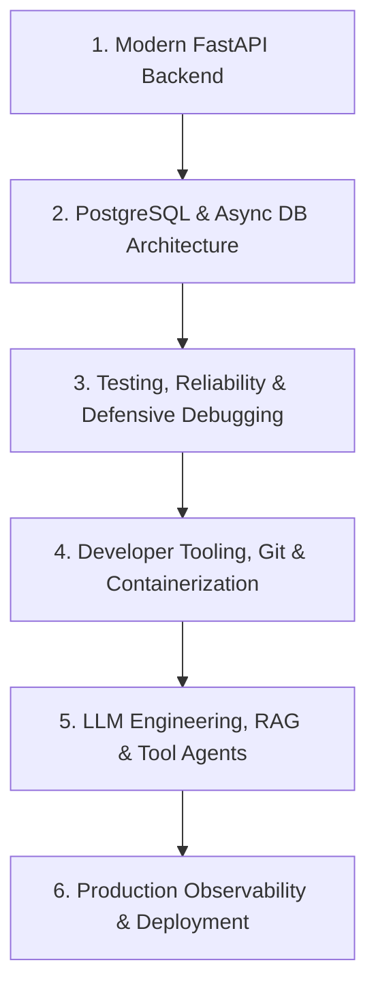

# Forge V1 — Learning Content Review Queue and Audit Report

**Author**: Antigravity Assistant & Engineering Pair  
**Date**: October 22, 2026  
**Status**: Authoritative Content Audit  
**Authoritative Local Tree**: `C:\My PC\git\Forge`  
**Classification**: Beginner Python/SQL/DSA path partly usable  

---

## 1. Executive Summary & Educational Integrity

Forge V1 adheres strictly to the core principle: **Static accepted course content is authoritative; AI must never fabricate approvals, simulate mastery, or silently publish unverified material.**

This document provides a complete and truthful accounting of all content currently in the Forge repository across the 9 Placement Foundations subjects, distinguishes legacy reference material from approved curricula, details the pending review queue, and documents the Applied AI Engineering scope extension.

---

## 2. Nine Placement Foundations Tracks & Topic Inventory

The confirmed Placement Foundations syllabus spans **157 topics** across nine distinct subjects:

| # | Subject Key | Subject Title | Outline Topics | Content Readiness | Beginner Exercises |
| -: | :--- | :--- | :---: | :--- | :---: |
| 1 | `python` | Python Programming | 17 | 19 Legacy Reference Lessons | 7 First Steps Ready |
| 2 | `sql-postgresql` | SQL and PostgreSQL | 14 | 14 Legacy Reference Lessons | 4 First Steps Ready |
| 3 | `dsa` | Data Structures & Algorithms | 20 | 20 Legacy Reference Lessons | 3 First Steps Ready |
| 4 | `quantitative-aptitude` | Quantitative Aptitude | 22 | Candidates in review queue | In preparation |
| 5 | `logical-reasoning` | Logical Reasoning | 20 | Candidates in review queue | In preparation |
| 6 | `verbal-english` | Verbal Ability & Communication | 20 | Candidates in review queue | In preparation |
| 7 | `system-design` | System Design Fundamentals | 16 | Candidates in review queue | In preparation |
| 8 | `ai-fundamentals` | AI, GenAI, RAG & Agents | 14 | Candidates in review queue | In preparation |
| 9 | `interview-communication` | Interview Communication | 14 | Candidates in review queue | In preparation |
| | **Total** | | **157** | **53 Legacy Lessons** | **14 Ready Exercises** |

*Note: All 157 topics remain manually accessible in the curriculum browser (`/curriculum`) regardless of recommendation state or publication level.*

---

## 3. Legacy Reference Bank vs. Approved Foundations

The repository contains 53 legacy reference lessons (`content/ai-engineer/v1/`):
- 19 Python reference lessons
- 14 SQL reference lessons
- 20 DSA reference lessons

### Honest Educational Distinctions
1. **Unreviewed Reference Material**: These 53 lessons were adapted during earlier experimental builds. They have **not** been approved under the strict Placement Foundations rubric.
2. **Zero Faked Approvals**: The system marks these lessons truthfully as `"Legacy reference bank (53 lessons)"`. They are never displayed as `"Approved Placement Foundations"`.
3. **Mastery Isolation**: Browsing or reading legacy reference lessons never awards mastery points. Mastery requires verified deterministic evidence from tests or coding arena submissions.

---

## 4. Prioritized Content Candidate Review Queue

To expand the usable learning path beyond the initial First Steps, candidate lesson and assessment batches must undergo human review in the following priority order:

### Batch 1: Python Beginner Foundations (P0)
- **Status**: Candidate authored in `data/learning-path/concept-steps.json`.
- **Topics**: Values and basic types, arithmetic precedence, conditionals (`if`/`elif`/`else`), loops (`for`/`while`), small functions, list manipulation, dictionary basics.
- **Review Criteria**: Executable starter code, deterministic unit tests, clear mental models, progressive hints, no undefined jargon.

### Batch 2: SQL Beginner Foundations (P0)
- **Status**: Candidate authored in `data/learning-path/beginner-exercises.json`.
- **Topics**: SELECT constant, column projections, WHERE clauses, NULL handling, ORDER BY/LIMIT, DISTINCT, COUNT/SUM/AVG, GROUP BY.
- **Review Criteria**: Small, readable fixture tables, PGlite compatibility, exact column contracts, no nondeterministic row order.

### Batch 3: DSA Pre-Algorithm & Array Foundations (P0)
- **Status**: Candidate authored in `data/learning-path/concept-steps.json`.
- **Topics**: Tracing arrays, index arithmetic, linear scanning, frequency maps, two pointers, basic time complexity intuition.
- **Review Criteria**: Concrete worked examples, step-by-step memory diagrams, deterministic test suites, no premature dynamic programming or tree problems.

### Batch 4: Aptitude, Reasoning, and English Level 1 (P1)
- **Topics**: Percentages & fractions, ratios & proportions, linear seating arrangements, basic syllogisms, subject-verb agreement, concise email writing.
- **Review Criteria**: Single-step logical reasoning, deterministic multiple-choice/numeric entry contracts, authored worked explanations.

### Batch 5: System Design, AI Foundations & Interview Communication (P1)
- **Topics**: Client-server HTTP fundamentals, stateless vs stateful services, prompt engineering, few-shot conditioning, STAR behavioral framework.
- **Review Criteria**: Objective rubric grading, deterministic criteria, zero hiring probability claims.

### Batch 6: Advanced Level 2 & Level 3 Progressions (P2)
- **Topics**: Sliding windows, trees/graphs, subqueries/CTEs, system partitioning, RAG vector pipelines.

---

## 5. Applied AI Engineering Scope Extension

To ensure Forge prepares learners for real-world production engineering, a 6-module applied engineering path was designed (`data/learning-path/applied-ai-scope-extension.json`):

### Module Breakdown
1. **Practical Python & Modern FastAPI Backend Development**:
   - Pydantic v2 validation, type annotations, asynchronous route handlers, dependency injection, middleware architecture, OpenAPI contract testing.
2. **PostgreSQL Integration & Async Database Architecture**:
   - SQLAlchemy 2.0 / SQLModel async sessions, Alembic migration strategies, connection pooling, indexing strategies, transaction boundaries.
3. **Testing, Reliability & Defensive Debugging**:
   - Comprehensive pytest suite design, fixture management, database isolation via in-memory engines, mock providers, deterministic error handling.
4. **Developer Tooling, Git Workflows & Containerization**:
   - Multi-stage Docker builds, non-root container security, `.dockerignore` optimization, Git worktree development, pre-commit hygiene.
5. **LLM Engineering, RAG & Tool-Calling Agents**:
   - Embeddings and cosine similarity, vector indexing (`pgvector`), prompt templating, deterministic structured output parsing, agent tool calling.
6. **Production Observability, Performance & Cloud Deployment**:
   - Structured JSON logging, health checks, rate limiting, Docker Compose local staging, environment secret isolation.

---

## 6. Truthful Final System Classification

**Final Classification**: **Beginner Python/SQL/DSA path partly usable**

### Rationale:
1. **What is Fully Usable**:
   - The concept-by-concept learning architecture is completely operational.
   - The deterministic 6-tier recommendation engine accurately prioritizes unfinished work, due reviews, prerequisites, and next concepts.
   - The 5-stage Coding Arena hierarchy correctly maps all 110 original problems.
   - 14 interactive First Steps exercises (Python, SQL, DSA) are fully authored, test-covered, and runnable with deterministic grading and sandboxed execution.
   - The redesigned Dashboard delivers a clean, focused "Continue Learning" experience free of manual planning friction.
2. **What Remains in Candidate / Preparation Stage**:
   - Placement Foundations tracks 4 through 9 (Aptitude, Reasoning, Verbal, System Design, AI Fundamentals, Interview Communication) are syllabus-mapped but await human editorial review of candidate lesson bundles.
   - 53 legacy reference lessons are honestly labeled as reference material and isolated from automated mastery credit.

This honest classification preserves learner trust, upholds Forge's strict audit standards, and establishes a clear path for upcoming content publication.
