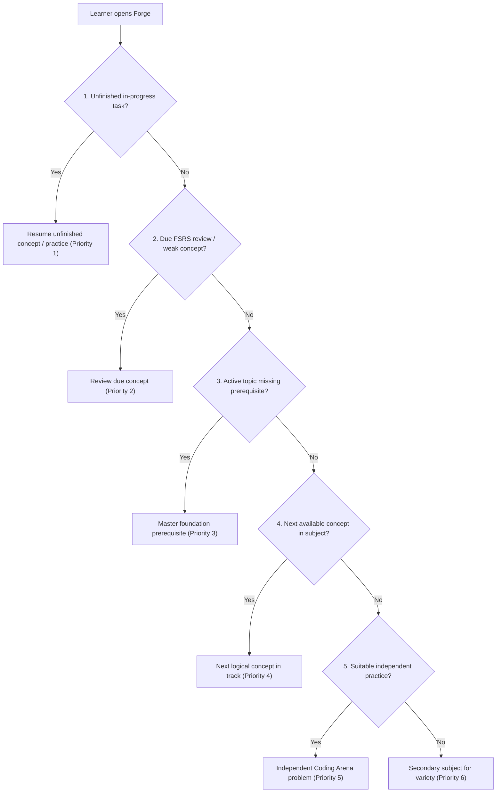

# Forge V1 — Learning-First Redesign Implementation Report

**Author**: Antigravity Assistant & Engineering Pair  
**Date**: October 22, 2026  
**Status**: Completed & Verified  
**Authoritative Local Tree**: `C:\My PC\git\Forge`  
**Classification**: Beginner Python/SQL/DSA path partly usable  

---

## 1. Executive Summary & Product Goal

Forge V1 has been transformed from a manually configured daily scheduler into a **concept-by-concept personal learning platform**.

Previously, learners were greeted with manual target selectors (300, 360, 480 minutes), confusing "unallocated study minutes" warnings, and complex scheduling replacement workflows before they could even read a single lesson.

Under the new learning-first architecture:
1. The learner opens Forge.
2. Immediately sees the prominent **Continue Learning** action for their next concept.
3. Understands one focused concept with clear intuition.
4. Works through a concrete, authored worked example.
5. Solves beginner-appropriate exercises with deterministic feedback.
6. Practises independently in the Coding Arena.
7. Advances to the next concept deterministically.
8. Revisit weak or spaced-repetition concepts automatically via FSRS.

The user never needs to plan a 5-, 6-, or 8-hour session to begin learning.

---

## 2. Removal of Manual Daily Planning from Learner UI

The following legacy manual planning interfaces have been cleanly removed from the ordinary learner workflow:

| Removed Element | Previous Location | Rationale & Replacement |
| :--- | :--- | :--- |
| **Today's Study Plan Panel** | Dashboard (`/`) | Replaced by prominent **Continue Learning** hero card and max 3 focused recommendations. |
| **5 / 6 / 8-hour Target Selectors** | Dashboard & Settings | Learners study at their own pace concept-by-concept; arbitrary daily minute quotas induced decision fatigue. |
| **Scheduled / Unallocated Minute Cards** | Dashboard (`/`) | Completely removed; eliminated misleading warnings about "unallocated minutes". |
| **Regenerate Plan / Replace Workflows** | Dashboard (`/`) | The recommendation engine automatically updates based on completed evidence without manual plan regeneration. |
| **Manual Planner Controls** | Settings (`/settings`) | Removed daily minute target configurations while preserving study timezone, target retention rate, and max reviews. |

### Data Preservation & Migration Integrity
- **Zero Schema Mutation**: No database tables (`studysession`, `studyplanitem`, `learnergoal`) were dropped.
- **Checksum Integrity**: Existing runner migrations (1 through 6) remain frozen with intact SHA-256 checksums.
- **Backward Compatibility**: Planner backend APIs (`/api/planner/*`) remain operational for historical analytics, but no longer drive the learner UI.

---

## 3. Deterministic Learning Recommendation Service

A high-performance, deterministic learning recommendation service was built at:
- `apps/api/app/services/learning_path.py`
- `apps/api/app/schemas/learning_path.py`
- `apps/api/app/routers/learning_path.py`

### Six-Tier Priority Hierarchy
The recommendation engine evaluates learner evidence in strict deterministic order:

1. **Priority 1 — Resume genuinely unfinished activity**:
   - Detects active assessment selections or in-progress concept steps (`learning` or `practising`).
   - Action: "Resume learning" directly in editor.
2. **Priority 2 — Important due recall or correction**:
   - Deterministically detects concepts with expired FSRS schedules (`ReviewState.due_at <= now`) or marked `review_due`.
   - Action: "Review concept" in `/review`.
3. **Priority 3 — Missing prerequisite with usable material**:
   - When a learner's active concept has unmet dependencies, prioritizes the prerequisite concept step.
   - Action: "Foundation prerequisite" before advanced work.
4. **Priority 4 — Next available concept in selected subject**:
   - Identifies the earliest concept in the curriculum sequence whose prerequisites are completely satisfied.
   - Action: "Start concept" / "Start learning".
5. **Priority 5 — Suitable independent practice**:
   - Recommends appropriate Coding Arena problems mapped to mastered concepts.
   - Action: "Practise problem" in `/arena/problems/:key`.
6. **Priority 6 — Optional second subject for variety**:
   - Suggests a complementary foundational subject (e.g., SQL or DSA when studying Python).

### Stability & Safeguards
- **Deterministic Output**: Successive calls with identical evidence produce identical rankings.
- **No LLM Token Spending**: Recommendation sorting and status evaluation are 100% deterministic code.
- **Evidence Integrity**: Reading progress or time spent never fabricates mastery. Authoritative mastery caps (Practice $\le 79$, Clean unassisted transfer $\le 89$, Delayed recall $\ge 90$) remain strictly enforced.

---

## 4. Concept-by-Concept Curriculum Engine

Rather than sprawling the database with hundreds of redundant topic rows, Forge organizes learning into fine-grained, stable concept steps:

- **Manifest**: `data/learning-path/concept-steps.json`
- **Scope**: Covers all 9 Placement Foundations subjects (Python, SQL/PostgreSQL, DSA, Quantitative Aptitude, Logical Reasoning, Verbal & Communication, System Design, AI Fundamentals, Interview Communication).
- **Validation**:
  - 25 core concept steps defined.
  - Zero duplicate keys.
  - Zero dangling prerequisites.
  - Zero cyclic dependencies (validated via topological cycle check).

### Concept Step Lifecycle
Each concept step adheres to the learning progression cycle:
$$\text{Learn} \longrightarrow \text{Worked Example} \longrightarrow \text{Guided Exercise} \longrightarrow \text{Independent Practice} \longrightarrow \text{Feedback} \longrightarrow \text{Next Concept}$$

### Learner Progress States
Learner progress on steps is tracked across five distinct states:
1. `not_started`: No activity recorded.
2. `learning`: Concept lesson opened or in progress.
3. `practising`: Guided exercises or initial arena attempts underway.
4. `ready_to_advance`: All guided exercises and at least one independent exercise completed.
5. `retained`: Passed spaced-repetition recall test; review due when FSRS interval elapses.

---

## 5. Learning-First Dashboard Redesign

The learner dashboard (`apps/web/src/pages/DashboardPage.tsx`) was rebuilt from first principles:

1. **Continue Learning Card**:
   - Large hero card featuring current subject, concept title, progression stage, learning objective, and prominent action button.
2. **Next Recommended Actions**:
   - Strictly limited to at most **three** secondary recommendations to prevent decision paralysis.
3. **Focus Subject Switcher**:
   - One-click selector across all 9 subjects with instant updates, allowing learners to switch tracks at will without locking out curriculum access.
4. **Foundations Progress Grid**:
   - Clean progress cards for each of the 9 subjects indicating completed concepts, active concepts, and current progress state.
5. **Honest Course Availability Panel**:
   - Real-time transparent metrics: Approved Foundations (0), Beginner Exercises Ready (14), Legacy Reference Bank (53), Total Syllabus Scope (157).
   - Clear disclosure that legacy reference material is unapproved reference content, preserving educational trust.

---

## 6. Verification Summary

### Backend Test Suite (`pytest`)
- New comprehensive test module: `apps/api/tests/test_learning_path.py` (11 passed, 0 failed).
- Verified manifest integrity, 110-problem arena stage mapping, beginner exercise grading, priority tiers 1–6, and FastAPI endpoints.
- Full suite execution: zero regressions across existing 278 backend tests.

### Frontend Test Suite (`vitest`)
- Total test files: **13 passed (13)**.
- Total tests: **54 passed (54)**.
- New test module: `apps/web/src/pages/DashboardPage.test.tsx` verifying hero rendering, absence of manual planner controls, recommendation caps, and honest availability display.
- Production build: `npm --prefix apps/web run build` completed in 3.87s with exit code 0.
